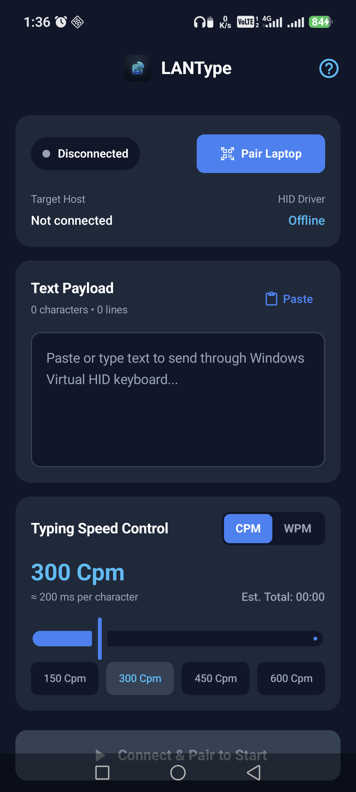
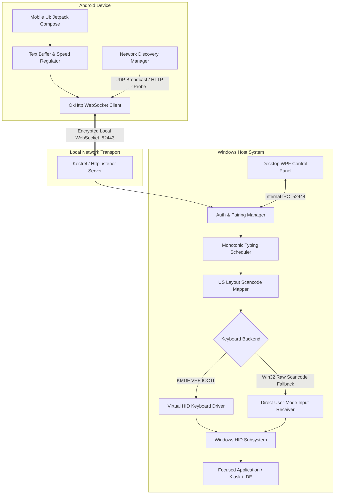

# LanType

<p align="center">
  
</p>

<p align="center">
  <b>Authenticated Local-Network Keyboard Streaming System for Windows & Android</b>
</p>

<p align="center">
  <a href="https://github.com/vanshtyagi001/LanType"></a>
  
  
  
  
  
  
</p>

---

## Overview

LanType is an enterprise-grade, low-latency keyboard streaming system that converts an Android mobile device into a dedicated input terminal for Windows workstations. Text entered or pasted into the mobile application is streamed over a local area network (LAN) or Windows Mobile Hotspot and injected directly into the target machine as genuine hardware keyboard scan codes.

By operating at the hardware scan code and Virtual HID Framework (VHF) level, LanType functions transparently across standard desktop software, terminal emulators, IDEs, and secure test environments (such as CodeTantra and kiosk browsers) that block standard clipboard paste events or synthetic input hooks.

<p align="center">
  
</p>

---

## Architectural Data Flow



---

## Key Capabilities

### 1. Hardware-Level Keystroke Emulation
- Translates incoming UTF-8 text streams into hardware-level keyboard scancodes (`KEYEVENTF_SCANCODE`) via `VkKeyScanW` and `MapVirtualKeyW`.
- Handles shift, control, and alt modifier sequencing atomically to eliminate desynchronization during high-speed burst transmission.
- Includes a Kernel-Mode Driver Framework (KMDF) driver based on the Microsoft Virtual HID Framework (VHF) that enumerates as a physical USB HID keyboard device in Windows Device Manager.

### 2. Kiosk and Lockdown Browser Compatibility
- Normalizes all line endings (`\r\n` and `\r` to `\n`) to ensure consistent, non-duplicating Enter key strokes in online code editors.
- Dispatches key down and key up transitions with microsecond-level dwell timing (`timeBeginPeriod(1)`) to avoid input filtering by kiosk browsers like CodeTantra.

### 3. Local-Subnet Privacy and Security
- Zero cloud dependencies: communication occurs entirely within the local Wi-Fi network or Windows Wi-Fi Direct Hotspot.
- Handshake authenticated via rotating 6-digit PIN and dynamic QR codes.
- Rate-limited authentication prevents brute-force attempts on local ports.
- Sensitive text payloads exist only in volatile memory and are never written to disk logs.

### 4. Dynamic Speed and Jitter Regulation
- Real-time rate control calibrated in Characters Per Minute (CPM) or Words Per Minute (WPM).
- Configurable typing speeds from 30 CPM up to 1,200 CPM (240 WPM).
- Active jitter compensation ensures uniform inter-keystroke intervals across variable Wi-Fi latency.

### 5. Failsafe Key State Management
- Invariant: all depressed modifier keys (Shift, Ctrl, Alt, Win) are guaranteed to be released upon pause, stop, session completion, emergency stop, or transport disconnection.

---

## Repository Structure

```
lan-keyboard/
├── android-app/                  # Native Android Application (Kotlin, Jetpack Compose)
│   ├── app/src/main/kotlin/      # UI screens, ViewModels, and networking layers
│   │   ├── data/network/         # WebSocket client, auto-discovery manager
│   │   ├── data/repository/      # Session and credential persistence
│   │   └── ui/                   # Jetpack Compose UI components and theme
│   └── build.gradle.kts          # Android build configuration
├── windows/
│   ├── desktop-app/              # WPF Control Panel (.NET 9, MVVM)
│   │   ├── Services/             # Embedded engine host and IPC client
│   │   ├── ViewModels/           # Main UI state and telemetry binding
│   │   └── app.manifest          # Elevation configuration (requireAdministrator)
│   ├── background-service/       # Core Typing Engine (.NET 9 Worker Service)
│   │   ├── Auth/                 # PIN generation and token validation
│   │   ├── Engine/               # TypingScheduler with multimedia precision
│   │   ├── Keyboard/             # VHF driver client & DevTestKeyboardReceiver
│   │   └── Server/               # LANWebSocketServer and Discovery service
│   ├── hid-driver/               # KMDF Virtual HID Keyboard Driver (C / WDK)
│   │   ├── driver.c              # DriverEntry, device add, and VHF initialization
│   │   └── LANTypeVhid.inf       # Driver installation manifest
│   └── installer/                # Inno Setup Packaging Configuration
│       ├── setup.iss             # Self-elevating installer script
│       └── dist/                 # Generated installation executable
├── shared/
│   └── protocol/                 # Shared Cross-Platform Protocol Contracts
│       ├── ProtocolModels.cs     # Polymorphic C# message records
│       └── ProtocolConstants.cs  # Default ports, boundaries, and timeouts
├── tests/                        # Comprehensive Test Suite
│   ├── CrossDeviceE2ETests.cs    # Automated end-to-end WebSocket simulation
│   ├── SchedulerTests.cs         # Precision timing and throughput validation
│   └── LayoutMapperTests.cs      # Scancode translation and modifier tests
└── docs/                         # In-depth architectural & platform manuals
    ├── architecture.md           # System data flow and security model
    ├── windows_guide.md          # Windows setup and troubleshooting
    ├── android_guide.md          # Mobile application guide
    └── driver_signing_guide.md   # Test-signing and VHF deployment details
```

---

## Technical Specifications

| Dimension | Specification |
|:---|:---|
| Host Platform | Windows 10, Windows 11 (x64) |
| Mobile Platform | Android 8.0 (API 26) through Android 15 (API 35) |
| Transport Protocol | WebSocket (RFC 6455) over TCP/IP |
| Default Communication Port | `52443` |
| Local Discovery Port | `52442` (UDP broadcast) |
| Serialization Format | Polymorphic JSON (`System.Text.Json` / `kotlinx.serialization`) |
| Typing Range | 30 to 1,200 CPM (6 to 240 WPM) |
| Clock Resolution | 1 millisecond (`winmm.dll` `timeBeginPeriod`) |
| Driver Framework | Windows Driver Frameworks (KMDF 1.15+, VHF) |

---

## Getting Started

### Prerequisites

#### Windows Workstation
- Windows 10/11 64-bit
- [.NET 9.0 Desktop Runtime](https://dotnet.microsoft.com/download/dotnet/9.0)
- Local Wi-Fi network or active Windows Mobile Hotspot

#### Android Device
- Android 8.0 or higher
- Camera permission (optional, for pairing QR code scanning)

---

### Installation

#### Option 1: Standalone Windows Installer
1. Download the latest `LANType-Setup-v1.0.0.exe` from the root directory or Releases.
2. Run the installer as Administrator.
3. Launch **LANType** from the Start Menu or desktop shortcut.

#### Option 2: Build from Source

**1. Clone the repository:**
```bash
git clone https://github.com/vanshtyagi001/LanType.git
cd LanType
```

**2. Build Windows Application & Run Tests:**
```powershell
# Restore and build the solution
dotnet build windows/desktop-app/LANType.Desktop.csproj -c Release

# Execute test suite (39 tests)
dotnet test tests/LANType.Tests.csproj
```

**3. Build Android Application:**
```bash
cd android-app
./gradlew assembleDebug
```
The output APK will be located at:
`android-app/app/build/outputs/apk/debug/app-debug.apk`

**4. Install to Connected Android Device via ADB:**
```bash
adb install -r android-app/app/build/outputs/apk/debug/app-debug.apk
```

---

## Operating Instructions

```
Step 1: Network Connection
┌───────────────────────────┐         Wi-Fi / Hotspot         ┌───────────────────────────┐
│     Windows Workstation   │ <─────────────────────────────> │       Android Device      │
│  Enable Mobile Hotspot    │                                 │  Connect to Hotspot Wi-Fi │
└───────────────────────────┘                                 └───────────────────────────┘

Step 2: Pairing Handshake
┌───────────────────────────┐                                 ┌───────────────────────────┐
│     LANType Desktop       │                                 │      LANType Mobile       │
│  Displays 6-digit PIN     │ ─── Enter PIN or Scan QR ─────> │  Tap "Connect to Laptop"  │
│  e.g., 575944             │                                 │  Handshake authenticates  │
└───────────────────────────┘                                 └───────────────────────────┘

Step 3: Streaming Keystrokes
┌───────────────────────────┐                                 ┌───────────────────────────┐
│     Active Application    │                                 │      LANType Mobile       │
│  Click cursor into target │ <── Keystrokes streamed live ── │  Paste / write text       │
│  editor / IDE / browser   │                                 │  Tap "Start Typing"       │
└───────────────────────────┘                                 └───────────────────────────┘
```

1. **Establish Local Network**: Enable Windows Mobile Hotspot in Windows Settings, and connect your Android device to that Wi-Fi network.
2. **Launch LANType Desktop**: Open LANType on Windows. The control panel will display your host IP and a 6-digit pairing PIN.
3. **Open LANType on Android**: The application will discover the host automatically. Tap **Connect to Laptop**, input the 6-digit PIN shown on your screen (or scan the QR code), and pair.
4. **Begin Typing**: Focus your cursor in Notepad, VS Code, or your web browser. Paste your text into the mobile app and tap **Start Typing into Laptop**.

---

## Protocol Specification

All WebSocket frames carry polymorphic JSON payloads identified by the `type` discriminant field:

### Client to Host
- **`PairRequest`**: Contains device metadata and the 6-digit PIN.
- **`StartTyping`**: Initiates typing with `sessionToken`, `text`, `speedUnit` (`Cpm` / `Wpm`), and `speedValue`.
- **`PauseTyping`**: Suspends active character emission without dropping state.
- **`ResumeTyping`**: Resumes emission from the current character index.
- **`StopTyping`**: Cancels active session and resets buffer.
- **`EmergencyStop`**: Immediate hard abort that forcibly releases all virtual keys.

### Host to Client
- **`PairResponse`**: Grants cryptographic `sessionToken` on success or reports error code.
- **`SessionState`**: Telemetry broadcast containing `charactersTyped`, `totalCharacters`, `state` (`Ready`, `Typing`, `Paused`, `Completed`, `Stopped`), and timing estimations.
- **`DriverStatus`**: Reports device attachment status and fallback mode.
- **`Heartbeat`**: Bi-directional keepalive ping/pong frame.

---

## Security Model

- **No Remote Exposure**: The WebSocket server binds exclusively to local private network interfaces (`192.168.x.x`, `10.x.x.x`, `172.16-31.x.x`, `127.0.0.1`).
- **Cryptographic Token Verification**: Once authenticated via PIN, each subsequent command requires a valid session token generated by `RNGCryptoServiceProvider`.
- **Brute-Force Mitigation**: Five consecutive invalid PIN attempts trigger an automatic temporary lockout on the host.
- **Hardware Isolation**: The driver enforces a strict Security Descriptor Definition Language (SDDL) DACL (`D:P(A;;GA;;;SY)(A;;GA;;;BA)`), ensuring unprivileged local processes cannot send arbitrary reports to the driver.

---

## Test Verification

The repository includes comprehensive unit, integration, and cross-device end-to-end tests:

```powershell
dotnet test tests/LANType.Tests.csproj --verbosity normal
```

```
Test Run Summary:
  Total Tests:  39
  Passed:       39
  Failed:        0
  Skipped:       0
  Duration:    980 ms
```

Key test coverage areas:
- `CrossDeviceE2ETests`: Full WebSocket handshake, invalid PIN rejection, and emergency key release.
- `SchedulerTests`: Delay calculations, pause/resume state invariants, and newline normalization.
- `LayoutMapperTests`: US keyboard mapping, shifted character scancodes, and modifier bitmasks.

---

## Contributing

1. Fork the repository at `https://github.com/vanshtyagi001/LanType`.
2. Create a feature branch: `git checkout -b feature/your-feature-name`.
3. Commit your changes following standard commit conventions.
4. Verify all tests pass: `dotnet test tests/LANType.Tests.csproj`.
5. Open a Pull Request detailing the architecture decisions and verification steps.

---

## License

Distributed under the MIT License. See [LICENSE](LICENSE) for more details.
