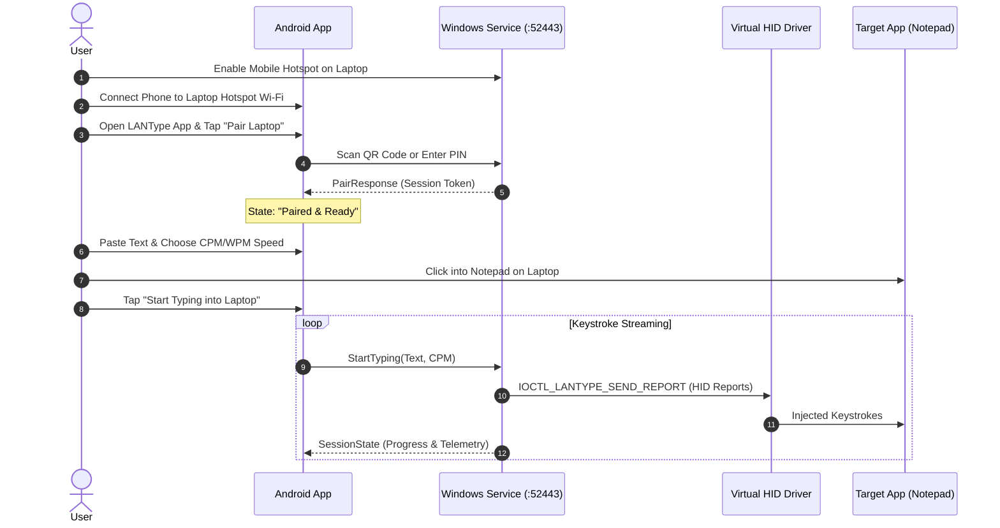

# LANType Android Application: Architecture & User Guide

## 1. System Overview

The LANType Android app is a native Kotlin application built with **Jetpack Compose**, **OkHttp WebSocket**, and **Google ML Kit Barcode Scanning**. It connects directly to the Windows Background Service over the local Wi-Fi Hotspot network and streams text into the Windows Virtual HID Keyboard driver.

---

## 2. Technical Stack

- **Platform**: Android (Min SDK: 26 / Android 8.0+, Target SDK: 35 / Android 15)
- **UI Framework**: Jetpack Compose with Material 3 Dark Palette
- **Architecture**: MVI / MVVM with Kotlin Coroutines & StateFlow
- **Networking**: OkHttp WebSocket (`LANWebSocketClient`)
- **Serialization**: Kotlinx Serialization JSON (`ProtocolModels.kt`)
- **Settings Storage**: Jetpack DataStore Preferences (`SettingsRepository`)
- **QR Code Scanner**: CameraX + Google ML Kit Barcode Scanning (`PairingDialog`)

---

## 3. How to Build & Install the Android App

### Option A: Using Android Studio (Recommended)
1. Launch **Android Studio**.
2. Select **Open** and choose the `android-app` folder (`D:\CSe\02-yGrade\lan-keyboard\android-app`).
3. Allow Gradle to sync dependencies.
4. Connect your Android phone via USB (with USB Debugging enabled) or start an Android Emulator.
5. Click **Run 'app'** (`Shift + F10`).

### Option B: Build APK from Command Line
In PowerShell:

```powershell
cd android-app
$env:JAVA_HOME = "E:\eSoftwares\Android\Android Studio\jbr"
$env:ANDROID_HOME = "$env:LOCALAPPDATA\Android\Sdk"
.\gradlew.bat assembleDebug
```

The compiled APK will be generated at:
`android-app/app/build/outputs/apk/debug/app-debug.apk`

To install directly to a connected phone:
```powershell
adb install -r app/build/outputs/apk/debug/app-debug.apk
```

---

## 4. End-to-End Operation Workflow



### Step-by-Step Instructions:

1. **Enable Mobile Hotspot**:
   - In Windows 10/11, go to **Settings > Network & internet > Mobile hotspot** and toggle it **On**.
2. **Connect Android Phone**:
   - On your phone, connect to the Windows laptop hotspot Wi-Fi network.
3. **Launch LANType Desktop App**:
   - Open LANType on Windows. It displays the Hotspot IP address (typically `192.168.137.1`), WebSocket port `52443`, a dynamic QR code, and a 6-digit PIN.
4. **Pair the Android App**:
   - In the Android app, tap **Pair Laptop**.
   - Tap **Scan QR** and point your phone camera at the QR code on your laptop screen (or enter the host IP and 6-digit PIN manually).
   - The app instantly pairs and displays the **Ready & Paired** status badge.
5. **Paste & Type**:
   - Paste or type your desired text in the large text box.
   - Adjust typing speed (e.g., 300 CPM or 60 WPM).
   - Click inside your destination window on Windows (Notepad, Word, browser, etc.).
   - Tap **Start Typing into Laptop**.
6. **Live Synchronization & Safety Controls**:
   - Watch the animated progress bar, character countdown, and live speed.
   - Tap **Pause** at any time. When you tap **Resume**, typing continues from the exact character index without duplicating or skipping text.
   - Tap **Stop** or **🚨 Kill** to halt typing immediately and safely release all keyboard keys.
