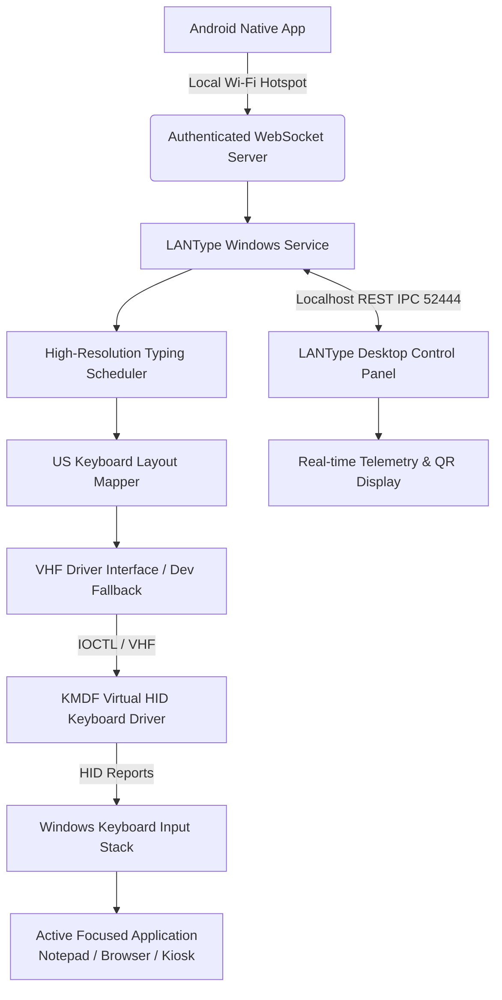

# LANType Architecture & Data Flow

## 1. System Overview

LANType is an authenticated, local-network typing system that allows an Android device to stream text directly into a Windows laptop as genuine hardware-level keyboard events.

---

## 2. Component Breakdown

### A. Shared Protocol (`shared/protocol/`)
- **Version**: `1.0`
- **Serialization**: System.Text.Json with polymorphic type discrimination.
- **Message Types**:
  - `PairRequest` / `PairResponse`: PIN-based authenticated handshake.
  - `Heartbeat`: Liveness tracking.
  - `StartTyping`: Text payload, CPM/WPM speed parameters, inter-key delay.
  - `PauseTyping` / `ResumeTyping` / `StopTyping`: Deterministic state transitions.
  - `EmergencyStop`: Immediate cancellation and all-keys-up release.
  - `SessionState`: Broadcasts characters typed, characters remaining, live speed, and estimated duration.
  - `DriverStatus`: Reports KMDF device enumeration state vs. dev test fallback.

### B. Windows Background Service (`windows/background-service/`)
- Hosted via `Microsoft.Extensions.Hosting.WindowsServices` as an SCM-managed Windows Service (`LANTypeService`) or standalone console executable.
- **WebSocket Server**: Listens on port `52443` for Android clients.
- **IPC Server**: Listens on `127.0.0.1:52444` for the Desktop Control Panel.
- **Typing Engine**: Uses monotonic `Stopwatch` timing:
  $$\text{delay\_ms} = \frac{60000}{\text{CPM}} = \frac{60000}{\text{WPM} \times 5}$$
- **Keyboard Layout Mapper**: Maps characters to standard USB HID usage codes (Page 0x07) and modifier bitmasks.
- **Driver Client**: Communicates via Win32 `DeviceIoControl` with `\\.\LANTypeVhidDevice` using `IOCTL_LANTYPE_SEND_REPORT` and `IOCTL_LANTYPE_RESET_KEYS`.

### C. KMDF Virtual HID Driver (`windows/hid-driver/`)
- Implements Microsoft Virtual HID Framework (VHF).
- Emits genuine 8-byte standard USB HID keyboard reports.
- Enumerates as a genuine keyboard device under the `Keyboards` category in Windows Device Manager.
- Secures the device object with SDDL `D:P(A;;GA;;;SY)(A;;GA;;;BA)` to prevent unprivileged processes from injecting keystrokes.

### D. Desktop Control Panel (`windows/desktop-app/`)
- Modern WPF (.NET 9) user interface with dark slate aesthetic.
- Generates dynamic pairing QR code and 6-digit PIN.
- Provides real-time typing telemetry and manual direct typing test capabilities.
- Operates independently from the service; closing the control panel does not interrupt the typing engine.

---

## 3. Security & Privacy Guarantees

1. **No External Network Requirement**: All networking occurs strictly over the local subnet (Hotspot/LAN). No third-party servers or telemetry endpoints are contacted.
2. **Authenticated Sessions**: Android clients must authenticate with the 6-digit pairing PIN before any typing command is accepted.
3. **Brute-Force Rate Limiting**: 5 failed PIN attempts trigger a 2-minute lockout.
4. **Privacy-Preserving Logs**: Sensitive text payloads are never written to disk logs; only character counts and timing telemetry are logged.
5. **Safe Key State Guarantee**: Pausing, stopping, disconnection, or emergency stop triggers an immediate `ReleaseAllKeys` report to ensure no stuck modifier or alphanumeric keys.
